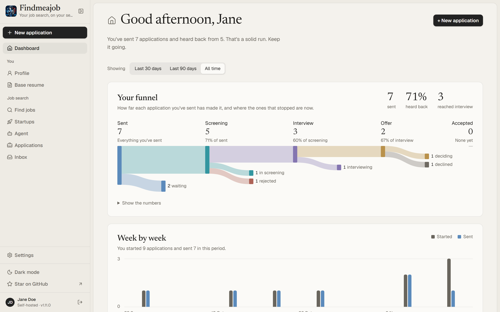
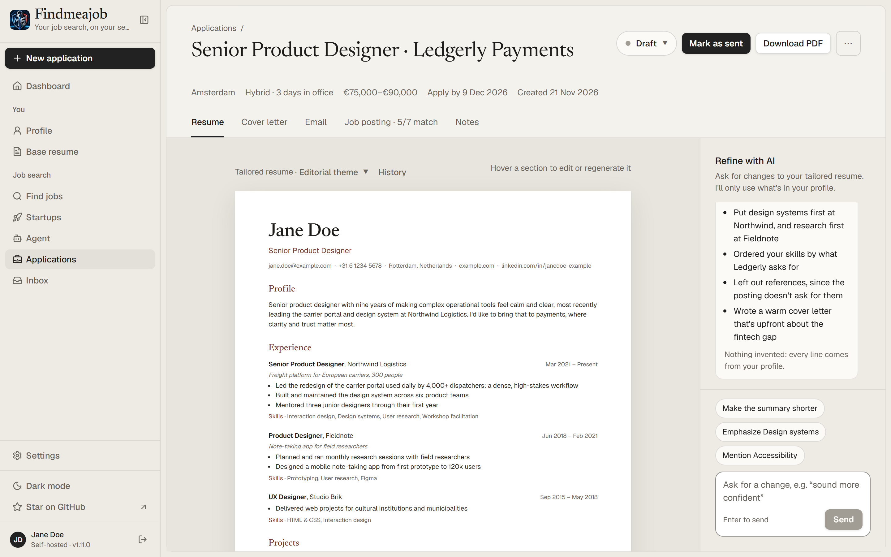
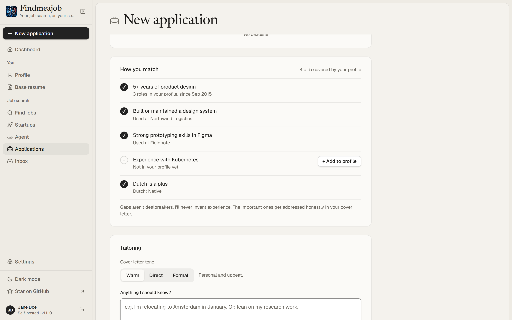
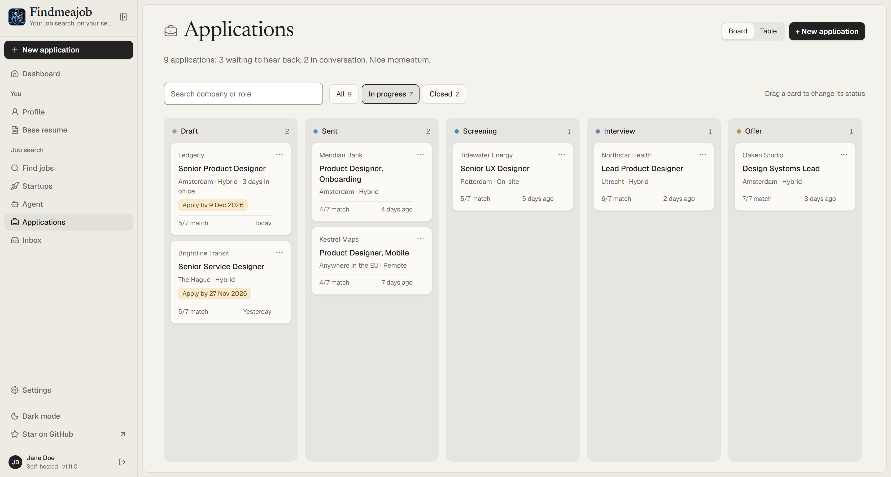
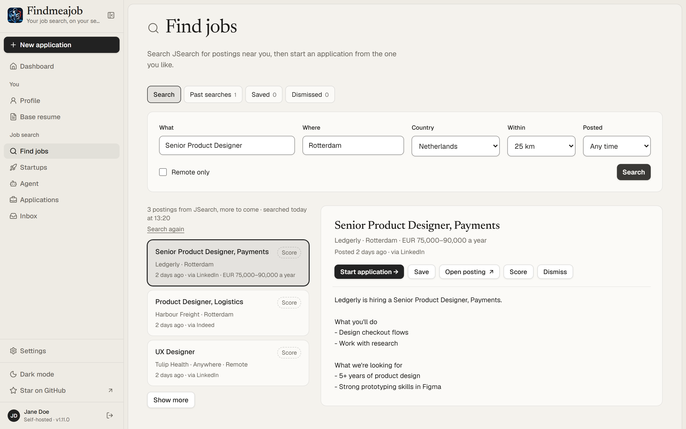
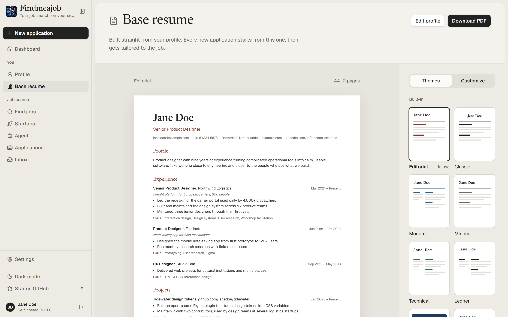
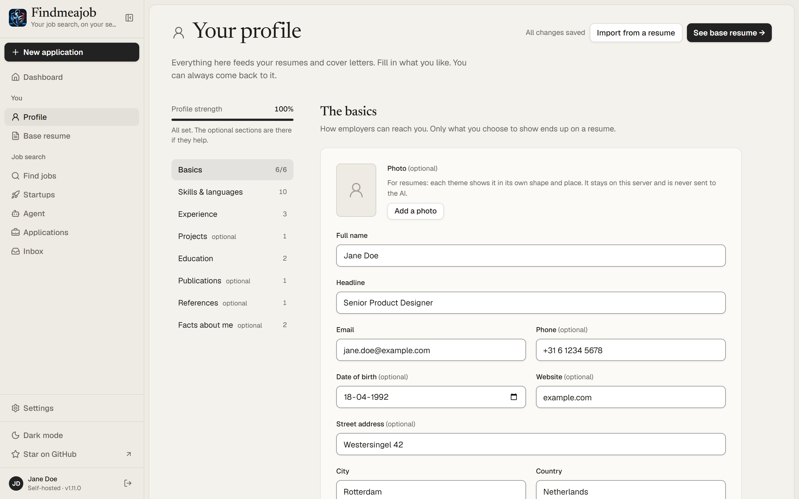
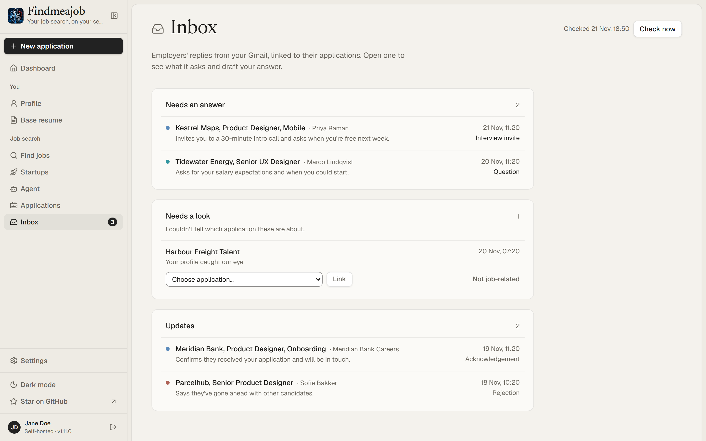
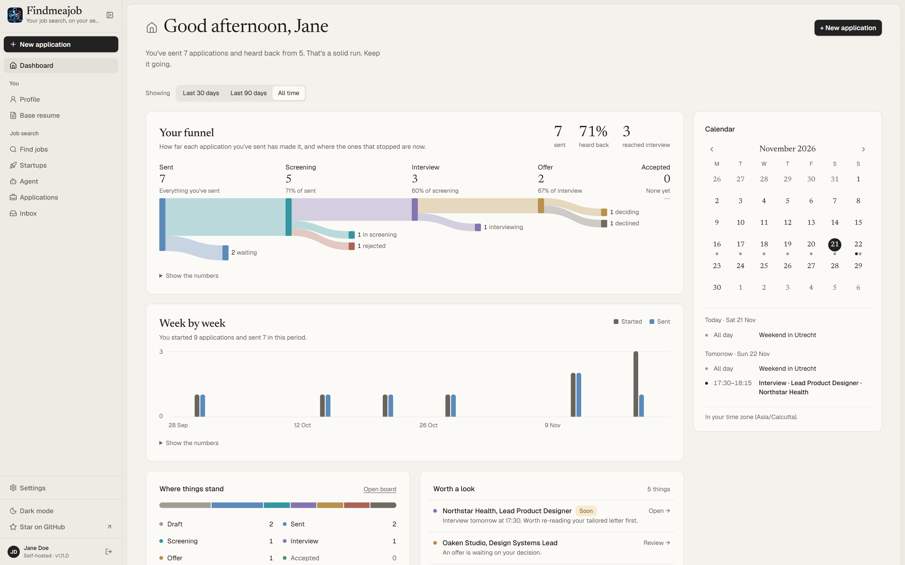

  

<h1 align="center">Findmeajob</h1>

Findmeajob keeps your career history in one profile and turns it into tailored resumes and cover letters for each job you apply to. It tracks every application, finds job postings, and can use an AI model running on your own computer (LM Studio or Ollama) or a hosted one.

This is a Windows edition of **[Dossier](https://github.com/AienTech/dossier)** 1.11.0 by AienTech, renamed and set up to run as ordinary personal software: **no Docker and no server**. A portable Node.js and PostgreSQL run from this folder, and everything stays on your computer.

## Screenshots

<table>
  <tr>
    <td width="50%"> An application: the tailored resume, and a chat to refine it</td>
    <td width="50%"> A new application: how you match the posting</td>
  </tr>
  <tr>
    <td> Every application on a board, from draft to offer</td>
    <td> Find jobs and start an application from a posting</td>
  </tr>
  <tr>
    <td> The base resume, with twelve themes and a theme builder</td>
    <td> One profile that every resume and letter comes from</td>
  </tr>
  <tr>
    <td> Replies from Gmail, read by the AI, with answers it drafts</td>
    <td> Your interviews and Google Calendar on the dashboard</td>
  </tr>
</table>

The screenshots show demo data: Jane Doe is made up. They're taken by <code>app/e2e/readme-images.ts</code> (see <code>app/playwright.readme.config.ts</code>).

More about every feature: [app/README.md](app/README.md).

## What's here

| Path | What it is |
|---|---|
| `app/` | The app's source (Next.js, Prisma, PostgreSQL), with the Windows changes |
| `findmeajob.ps1` | Starts and stops the database and the app; sets the password |
| `Start Findmeajob.cmd`, `Stop Findmeajob.cmd`, `Change Password.cmd` | Double-click launchers for `findmeajob.ps1` |
| `tools/hash-password.mts` | Makes the password hash the app signs in with |
| `README-WINDOWS.txt` | Day-to-day use, LM Studio setup, timings, and the list of changes from Dossier |

## Setting it up on a new Windows computer

The portable runtimes aren't in this repository, because they're large. To set it up:

1. Clone this repository, for example to `C:\Users\<you>\Findmeajob`.
2. Put these in a `runtime` folder next to `app`:
   - `runtime\node`: Node.js 24 for Windows (the zip version)
   - `runtime\pgsql`: PostgreSQL 18 for Windows (the zip version of the binaries)
   - `runtime\ms-playwright`: Chromium for PDFs. Install it with `npx playwright install chromium-headless-shell` with `PLAYWRIGHT_BROWSERS_PATH` set to that folder.
3. Create the database: run `runtime\pgsql\bin\initdb -D data\pg -U postgres -A scram-sha-256 -W`, set `port = 5433` in `data\pg\postgresql.conf`, start it, and create a database named `dossier`.
4. In `app`, copy `.env.example` to `.env` and fill in:
   - `DATABASE_URL` pointing at port 5433
   - `DOSSIER_SECRET`, from `openssl rand -base64 48`
   - `DOSSIER_DATA_DIR`
   - `PORT=3210` and `HOSTNAME=127.0.0.1`
5. In `app`, install the dependencies with `corepack yarn install`, then build with `corepack yarn build`. Build it in the folder it will run from: the build links libraries by their full path.
6. Copy `app\.next\static` to `app\.next\standalone\.next\static`, and `app\public` to `app\.next\standalone\public`.
7. Double-click **Start Findmeajob.cmd**. It asks for a password the first time, then opens http://localhost:3210.

For AI, install [LM Studio](https://lmstudio.ai) and turn on its server (Settings → Local Model API). Then choose LM Studio in Findmeajob's Settings → AI provider. Qwen3 4B (`qwen/qwen3-4b-2507`) works well on a laptop with a 6 GB graphics card.

## License

AGPL-3.0, as Dossier is: see [app/LICENSE](app/LICENSE). Findmeajob is a modified version of Dossier; the changes are listed in [README-WINDOWS.txt](README-WINDOWS.txt).
